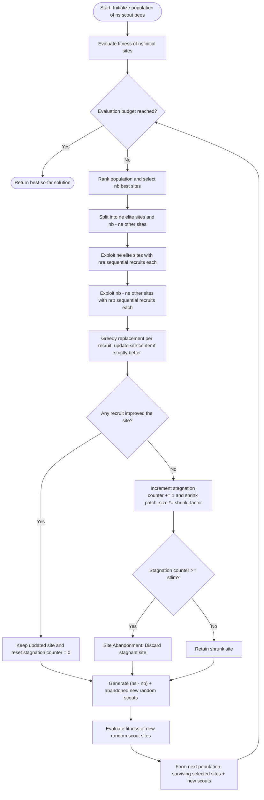

# Problem 1 — Optimisation Using the Bees Algorithm

Problem 1 applies the **Bees Algorithm (BA)** [1] to two optimisation tasks: **Part A** (Symmetric Travelling Salesman Problem) and **Part B** (Continuous Function Optimisation).

## Bees Algorithm

The Bees Algorithm is a population-based metaheuristic inspired by honeybee foraging. It maintains a population of `ns` scout bees, where each bee represents a candidate solution and carries a local neighbourhood size (`patch_size`) and stagnation counter.

Within each selected site, recruited bees are evaluated **sequentially with greedy replacement**: as soon as a recruited neighbour improves upon the site's current fitness, it immediately replaces the site center (resetting `stagnation_count = 0`), and subsequent recruits in that cycle search around the updated solution. If no recruit improves the site during the cycle, `stagnation_count` is incremented and `patch_size` is multiplied by `shrink_factor`. Any site reaching `stagnation_count >= stlim` is then abandoned and replaced alongside the `ns - nb` non-selected scouts by fresh random global scouts.



Each run has a strict budget of **30,000 objective evaluations**, counting initial scouts, all recruited neighbours, and all fresh global scouts (including rejected candidates). Execution stops immediately when the budget is reached, allowing an incomplete final iteration.

After evaluating the $ns$ initial scouts, the number of evaluations performed in cycle $t$ is:

$E_t = ne \cdot nre + (nb - ne) \cdot nrb + (ns - nb) + a_t$

where $a_t \in [0, nb]$ is the number of stagnated sites abandoned in cycle $t$. Letting $E_{\text{base}} = ne \cdot nre + (nb - ne) \cdot nrb + (ns - nb)$ and $A = \sum_t a_t$ be the total abandoned sites over the run, the number of cycles required to exhaust a budget $B$ is:

$$K \approx \left\lceil \frac{B - ns - A}{E_{\text{base}}} \right\rceil$$

## Part A — Symmetric Travelling Salesman Problem (TSP)

The symmetric TSP requires visiting every city exactly once and returning to the starting city with minimum total round-trip distance.

A solution is represented as a permutation $\pi = (\pi_1, \dots, \pi_n)$ with city `1` fixed at the first position ($\pi_1 = 1$). The tour length sums all consecutive edges plus the return edge:

$$L(\pi) = \sum_{i=1}^{n-1} d_{\pi_i, \pi_{i+1}} + d_{\pi_n, \pi_1}$$

Edge distances follow the TSPLIB `EUC_2D` rounded Euclidean distance rule [4], rounded per edge before summing:

$$d_{ij} = \text{floor}\left(\sqrt{(a_i - a_j)^2 + (b_i - b_j)^2} + 0.5\right)$$

Solution quality against the published optimal tour length $L^*$ [3] is measured by percentage gap:

$$\text{Gap}(\%) = 100 \cdot \frac{L_{BA} - L^*}{L^*}$$

- **Data:** Six TSPLIB instances (`eil51`, `berlin52`, `st70`, `eil76`, `kroA100`, `ch150`) stored in `bees_algorithm/data/`. See [`data/README.md`](data/README.md) for the instance table, optimal tour lengths, official download URLs, file format, and validation rules.
- **Initialisation:** Uniform random shuffle of cities `2..n` with city `1` fixed at index `0`.
- **Neighbourhoods:** Two single-move versions are compared under the same settings and seeds, both choosing two movable indices $1 \le i < j \le n - 1$ (keeping city `1` fixed) with index span $j - i \le \lceil (n - 2) \cdot \text{patch\_size} \rceil$:
  - **`SWAP`:** Exchanges the two cities at positions $i$ and $j$.
  - **`REVERSE`:** Reverses the segment from $i$ through $j$ inclusive.
- **Validation:** Every final tour must contain each city `1..n` once, start at city `1`, and match its recomputed rounded Euclidean round-trip distance.

## Part B — Continuous Function Optimisation

Each candidate solution is a real-valued vector $\mathbf{x} \in \mathbb{R}^D$, evaluated at dimensions **$D = 10$** and **$D = 30$** on four unshifted, noiseless benchmark functions from Surjanovic and Bingham's Simon Fraser University collection [5–8] (where $\mathbf{0}$ and $\mathbf{1}$ denote the all-zero and all-one vectors):

- **Sphere** [5]:
  $$f(\mathbf{x}) = \sum_{i=1}^D x_i^2$$
  Bounds: $x_i \in [-5.12, 5.12]$. Global minimum: $f(\mathbf{0}) = 0$. Convex, unimodal.

- **Rosenbrock** [6]:
  $$f(\mathbf{x}) = \sum_{i=1}^{D-1} \left[100(x_{i+1} - x_i^2)^2 + (1 - x_i)^2\right]$$
  Bounds: $x_i \in [-5, 10]$. Global minimum: $f(\mathbf{1}) = 0$. Narrow curved valley.

- **Rastrigin** [7]:
  $$f(\mathbf{x}) = 10D + \sum_{i=1}^D \left[x_i^2 - 10\cos(2\pi x_i)\right]$$
  Bounds: $x_i \in [-5.12, 5.12]$. Global minimum: $f(\mathbf{0}) = 0$. Highly multimodal.

- **Ackley** [8]:
  $$f(\mathbf{x}) = -20\exp\left(-0.2\sqrt{\frac{1}{D}\sum_{i=1}^D x_i^2}\right) - \exp\left(\frac{1}{D}\sum_{i=1}^D \cos(2\pi x_i)\right) + 20 + \exp(1)$$
  Bounds: $x_i \in [-32.768, 32.768]$. Global minimum: $f(\mathbf{0}) = 0$. Multimodal with a flat outer region.

- **Initialisation:** Each coordinate is sampled uniformly within its lower and upper bounds $[l, u]$.
- **Neighbourhood & bounds handling:** Each coordinate is independently perturbed by a uniform step in $[-(u - l)\cdot\text{patch\_size},\ +(u - l)\cdot\text{patch\_size}]$ (starting at `ngh = 0.1`, i.e. ±10% of the allowed range, and shrinking by `shrink_factor` on stagnation) and clipped to $[l, u]$.

## Experimental Settings

| Parameter | Description | Part A (TSP) | Part B (Continuous) |
| :--- | :--- | ---: | ---: |
| `max_evaluations` | Objective evaluations per run | `30000` | `30000` |
| `ns` | Scout population size | `10` | `25` |
| `ne` | Elite sites | `1` | `3` |
| `nb` | Total selected sites (includes elites) | `3` | `10` |
| `nre` | Recruited bees per elite site | `120` | `15` |
| `nrb` | Recruited bees per non-elite selected site | `10` | `5` |
| `stlim` | Stagnation limit before abandonment | `45` | `18` |
| `ngh` | Initial patch size ratio | `1.0` | `0.1` |
| `shrink_factor` | Patch multiplier on stagnation | `0.98` | `0.8` |

- **Hyperparameter selection:** Candidate parameter sets for Part A (TSP) and Part B (Continuous) were compared using [`utils/tune_configs.py`](utils/tune_configs.py) (`python -m bees_algorithm.utils.tune_configs`) before fixing the final settings in [`configs.py`](configs.py).
- **Seeds:** 10 independent runs per case using seeds `45, 46, 47, 48, 49, 50, 51, 52, 53, 54`.
- **Total runs:** **120** TSP runs (6 instances × 2 neighbourhoods × 10 seeds) and **80** continuous runs (4 functions × 2 dimensions × 10 seeds).

## Saved Results & Figures

All raw per-run logs, convergence histories, summary tables, run metadata, and generated plots live under [`results/`](results/README.md):

- **Overview & layout:** [`results/README.md`](results/README.md) · [`results/metadata.json`](results/metadata.json)
- **Part A (TSP) tables & figures:** [`summary_tsp.md`](results/part_a_tsp/tables/summary_tsp.md) · [`summary_tsp.csv`](results/part_a_tsp/tables/summary_tsp.csv) · [`convergence_berlin52.png`](results/part_a_tsp/figures/convergence_berlin52.png) · [`convergence_ch150.png`](results/part_a_tsp/figures/convergence_ch150.png) · [`best_route_berlin52.png`](results/part_a_tsp/figures/best_route_berlin52.png)
- **Part B (Continuous) tables & figures:** [`summary_continuous.md`](results/part_b_continuous/tables/summary_continuous.md) · [`summary_continuous.csv`](results/part_b_continuous/tables/summary_continuous.csv) · [`convergence_rastrigin_D10.png`](results/part_b_continuous/figures/convergence_rastrigin_D10.png) · [`boxplots_D30.png`](results/part_b_continuous/figures/boxplots_D30.png)

## Setup & Reproducing Results

- **Environment:** Python `3.14.6` (requires `>=3.10`), `numpy 2.5.5` (`>=1.26`), `matplotlib 3.11.2` (`>=3.8`), `pytest 9.2.0` (`>=8.0`).
- **Data location:** [`bees_algorithm/data/`](data/README.md)

Run from the repository root:

```bash
# Install dependencies and verify tests
python -m pip install -r requirements.txt
python -m pytest bees_algorithm/tests -v

# One TSP run (Part A, 30,000 evaluations)
python -m bees_algorithm.optimise --instance berlin52 --neighbourhood REVERSE --seed 45

# One continuous run (Part B, 30,000 evaluations)
python -m bees_algorithm.optimise --function rastrigin --dimension 10 --seed 45

# Full Problem 1 experiment set (120 TSP + 80 continuous runs, tables, and plots)
python -m bees_algorithm.optimise

# Full project pipeline (Problem 1 & Problem 2)
python main.py

# Regenerate summary tables and plots from saved results
python -m bees_algorithm.utils.summarizer
python -m bees_algorithm.utils.plotting
```

## References

1. Pham, D. T., Ghanbarzadeh, A., Koç, E., Otri, S., Rahim, S., & Zaidi, M. **The Bees Algorithm — A Novel Tool for Complex Optimisation Problems**. *Intelligent Production Machines and Systems*, 2006, pp. 454–459. [Publisher record](https://www.sciencedirect.com/science/article/abs/pii/B978008045157250081X).
2. Reinelt, G. **TSPLIB**. Heidelberg University. [Library home page](https://comopt.ifi.uni-heidelberg.de/software/TSPLIB95/).
3. Reinelt, G. **Optimal solutions for symmetric TSPs**. [Reference tour lengths](https://comopt.ifi.uni-heidelberg.de/software/TSPLIB95/tsp/TSP-BEST.html).
4. Reinelt, G. **TSPLIB 95 documentation**, Sections 1 and 2.1 on file format and Euclidean distances. [Documentation PDF](https://comopt.ifi.uni-heidelberg.de/software/TSPLIB95/tsp/tsp95.pdf).
5. Surjanovic, S., & Bingham, D. **Sphere Function**. Simon Fraser University. [Function and implementation](https://www.sfu.ca/~ssurjano/spheref.html).
6. Surjanovic, S., & Bingham, D. **Rosenbrock Function**. Simon Fraser University. [Function and implementation](https://www.sfu.ca/~ssurjano/rosen.html).
7. Surjanovic, S., & Bingham, D. **Rastrigin Function**. Simon Fraser University. [Function and implementation](https://www.sfu.ca/~ssurjano/rastr.html).
8. Surjanovic, S., & Bingham, D. **Ackley Function**. Simon Fraser University. [Function and implementation](https://www.sfu.ca/~ssurjano/ackley.html).
