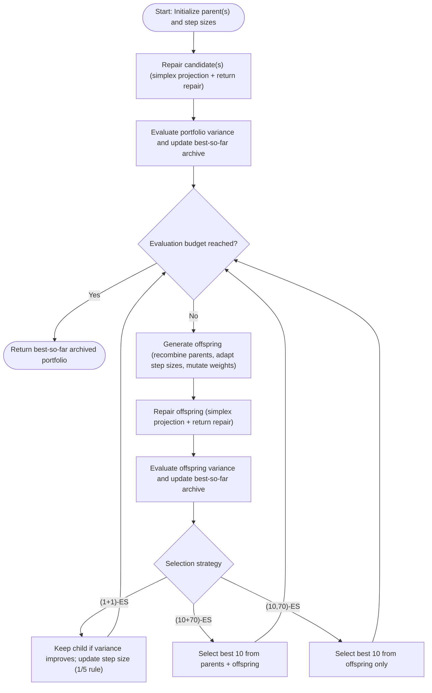

# Problem 2: Portfolio optimization with Evolution Strategies

ACIT4610 Evolutionary Artificial Intelligence and Robotics, Fall 2026, Group 7.

This package implements and evaluates three continuous Evolution Strategy (ES) variants for long-only minimum-variance portfolio optimization with a required expected return. Run all commands from the repository root (the directory containing `evolution_strategy/`).

## Problem formulation

The covariance matrix is constructed once when each dataset is loaded:

$$
\Sigma_{ij} = s_i s_j \rho_{ij}
$$

The portfolio variance is then calculated as $V(\mathbf{w}) = \mathbf{w}^{T}\Sigma\mathbf{w}$.

The implementation stores and reuses the symmetric covariance matrix during objective evaluations, using cached NumPy arrays in `evaluation.py` to vectorize return and variance calculations.

A candidate solution is a vector of asset weights $\mathbf{w} = (w_1, \ldots, w_n)$. We minimize portfolio variance:

$$
V(\mathbf{w}) =
\sum_{i=1}^{n} w_i^2 s_i^2
+ 2\sum_{i=1}^{n}\sum_{j=i+1}^{n}
w_i w_j s_i s_j \rho_{ij}
$$

subject to non-negative weights, full budget allocation, and a minimum expected return:

$$
w_i \geq 0, \qquad
\sum_{i=1}^{n} w_i = 1, \qquad
R(\mathbf{w}) = \sum_{i=1}^{n} w_i r_i \geq R^*
$$

Here $r_i$ is the expected return of asset $i$, $s_i$ is its standard deviation, and $\rho_{ij}$ is the correlation between assets $i$ and $j$. Target returns are set for $\alpha \in \{0.25, 0.50, 0.75\}$:

$$
R^* = (1 - \alpha) R_{\mathrm{eq}} + \alpha R_{\max}
$$

where $R_{\mathrm{eq}}$ is the return of an equally weighted portfolio and $R_{\max}$ is the highest individual asset return.

## Datasets

The five OR-Library portfolio benchmark files (`port1.txt`–`port5.txt`) are included in [`evolution_strategy/data/`](data/). See **[`data/README.md`](data/README.md)** for the file format, summary statistics, exploratory data analysis, and the `port1.txt` parser validation checkpoint.

## Algorithms and constraint repair



All three ES variants are implemented in `algorithms.py` and exposed through `run_es()` in `evolution_strategies.py`:

| Variant | Algorithm | Survivor selection |
|---|---|---|
| `one_plus_one` | (1+1)-ES | Replace parent with offspring only on strictly lower variance |
| `ten_plus_seventy` | (10+70)-ES | Keep the best 10 from 10 parents and 70 offspring |
| `ten_comma_seventy` | (10,70)-ES | Keep the best 10 from the 70 offspring only |

`(1+1)-ES` starts from one repaired random portfolio with Gaussian step size `sigma = 0.1 / sqrt(n)`. After each evaluated child, `sigma` is multiplied by `exp(1/3)` on a strict improvement and by `exp(-1/12)` otherwise, clamped to `[1e-8, 1.0]`. Initialization counts as one objective evaluation.

`(10+70)-ES` and `(10,70)-ES` maintain 10 parents and generate up to 70 offspring per generation, shrinking the final batch if needed to stop at the exact evaluation budget. Each offspring picks two distinct parents at random, averages their weights, and takes the geometric mean of their per-asset step sizes. Step sizes are then mutated log-normally using `tau_prime = 1 / sqrt(2n)` and `tau = 1 / sqrt(2 sqrt(n))` (clamped to `[1e-8, 1.0]`), and weights are perturbed with Gaussian noise. All three variants track a best-so-far archive of feasible repaired portfolios, so recorded convergence curves never rise even for `(10,70)-ES`, where the current parent population can worsen between generations.

Before any initial or mutated candidate is evaluated, `repair.py` restores feasibility in two steps. First it projects the raw vector onto the Euclidean simplex ($w_i \geq 0$, $\sum_i w_i = 1$). Then, if $R(\mathbf{w}) < R^*$, it blends $\mathbf{w}$ with a unit weight on the highest-return asset using the smallest mixing fraction that hits $R^*$. Final feasibility is checked to tolerance `1e-8` on non-negativity, unit sum, and target return.

All initial weight coordinates are independently sampled
from a uniform distribution in [0, 1] before repair.

The population variants initialize every coordinate's
step size to `0.1 / sqrt(n)`. Each offspring uses one shared
standard-normal draw for global step-size adaptation,
independent coordinate-specific draws, and fresh independent
Gaussian draws for weight mutation.

In (10,70)-ES, the best-so-far archive is used for reporting
only and does not participate in parent or survivor selection.

## Running the code

### Validated execution environment

| Component | Tested version | Requirement |
|---|---|---|
| Operating system | Windows / macOS | — |
| Python | 3.13.5 / 3.14.6 | `>=3.10` |
| NumPy | 2.5.4 | `>=1.26` |
| Matplotlib | 3.11.2 | `>=3.8` |
| pytest | 9.2.0 | `>=8.0` |

NumPy is used for vectorized objective evaluation (`evaluation.py`) and plotting.

From the repository root:

```bash
python -m pip install -r requirements.txt
python -m pytest evolution_strategy/tests -v
```

The ES regression tests cover simplex projection,
target-return repair, (1+1)-ES step-size adaptation,
evaluation budgets, best-so-far archive tracking,
covariance construction, assignment reference values,
and independent variance calculations.

Latest validation:

- ES regression suite: 66 passed.
- Covariance regression suite: 33 passed.
- Archive regression suite: 5 passed.
- Overall project regression suite: 120 passed.
- Archive numerical equivalence: 150/150 comparisons passed.

### Full pipeline via `main.py`

Running the root entry point executes both Problem 1 (Bees Algorithm) and Problem 2 (Evolution Strategies):

```bash
python main.py
```

For Problem 2, `main.py` calls `optimise_es()`, `summarize_all_es()`, and `generate_all_plots_es()`. Every run recomputes and overwrites all 45 cases directly under `evolution_strategy/results/`, rebuilds the consolidated summary CSV, and regenerates the required plots.

### Individual commands

Experiments and summary building:

```bash
# Single seeded run (30,000 evaluations)
python -m evolution_strategy.optimise --dataset port1 --alpha 0.50 --variant one_plus_one --seed 0

# One complete test case (port1_alpha050: all 3 ES variants × 10 seeds × 30,000 evaluations)
python -m evolution_strategy.optimise --dataset port1 --alpha 0.50

# Full Problem 2 experiment set (45 cases, 450 runs, summary CSV, and plots)
python -u -m evolution_strategy.optimise

# Rebuild the consolidated summary CSV from saved cases
python -m evolution_strategy.build_summary
```

Every full invocation of `optimise` (without selective flags) runs all 45 cases, overwrites the outputs in `evolution_strategy/results/`, and regenerates the figures.

### Generating LaTeX report tables (optional)

To generate standalone LaTeX report tables for both Problem 1 (BA) and Problem 2 (ES) from the saved summary CSVs without rerunning optimization:

```bash
python generate_tex_tables.py
```

The generated `.tex` files are written to `tex_tables/` at the repository root (gitignored).

### Generating figures without rerunning optimization

```bash
# Required port5_alpha050 convergence plot and comparison plots
python -m evolution_strategy.plot_results

# Comparison plots only (mean variance, runtime, and port5 alpha=0.50 boxplot; PNG + PDF)
python -m evolution_strategy.plot_comparisons
```

## Experimental protocol and saved outputs

| Setting | Value |
|---|---|
| Datasets | 5 (`port1` to `port5`) |
| Return targets ($\alpha$) | `0.25`, `0.50`, `0.75` |
| ES variants | 3 (`one_plus_one`, `ten_plus_seventy`, `ten_comma_seventy`) |
| Seeds per case | `0` through `9` (10 independent runs via `random.seed(seed)`) |
| Budget per seed | `30,000` objective evaluations (`max_iterations` counts evaluations, including initialization and rejected offspring) |
| Totals | 45 cases, 450 runs, 13,500,000 objective evaluations |

`results.py` summarizes each 10-run case using best variance,
mean variance, population standard deviation (denominator `N`),
feasible-run percentage, mean runtime, and the mean archive
convergence curve.

Variance statistics are calculated over valid runs only,
while mean runtime is calculated across all ten runs.

Raw outputs and report artifacts are stored inside the repository:

```text
evolution_strategy/
├── data/
│   ├── port1.txt
│   ├── port2.txt
│   ├── port3.txt
│   ├── port4.txt
│   ├── port5.txt
│   ├── dataset_correlations.png
│   └── README.md
├── results/
│   ├── es_summary_45_cases.csv
│   ├── figures/
│   └── <case_name>/
│       ├── summary.csv
│       ├── runs.csv
│       ├── convergence.csv
│       ├── run_histories.csv
│       └── complete.json
└── tests/                     # Regression tests
```

## Module overview

| Module | Role |
|---|---|
| `portfolio.py` | Load OR-Library datasets and construct covariance matrices |
| `evaluation.py` | Expected return, NumPy-cached covariance-based variance, and target-return calculations |
| `repair.py` | Euclidean simplex projection and target-return mixing |
| `algorithms.py` | `(1+1)-ES`, `(10+70)-ES`, and `(10,70)-ES` with best-so-far archive |
| `evolution_strategies.py` | Single-seed runner, runtime tracking, and feasibility check |
| `results.py` | 10-seed case summarization, mean convergence history, default paths |
| `optimise.py` | CLI for single run, single test case, or full 45-case ES pipeline (`optimise_es`) |
| `build_summary.py` | Consolidated 45-case summary builder (`summarize_all_es`) |
| `plot_results.py` | `port5_alpha050` convergence plot and unified plot entry point (`generate_all_plots_es`) |
| `plot_comparisons.py` | Mean-variance, runtime, and per-seed boxplot comparisons |

## Experimental results provenance

The existing 450-run experimental dataset was committed
in revision `8768729`, before the covariance precomputation
update in revision `173116b` and the explicit separate
(1+1)-ES archive correction in revision `8c92b9f`.

Subsequent implementation validation included:

- 500 numerical objective comparisons.
- 45 seeded comparisons at 1,000 evaluations.
- Nine representative runs at 30,000 evaluations.
- One complete ten-seed case reproduction.
- 33 permanent covariance regression tests.
- Five permanent archive regression tests.
- 150 paired archive equivalence comparisons across
  five datasets, three return targets, and ten seeds.
- 66 passing ES regression tests.
- 103 passing overall project regression tests.

The nine full-budget checks covered port1, port3, and port5
at alpha = 0.50, seed 0, using all three ES variants.
All nine reproduced the recorded final variance within
numerical tolerance, satisfied feasibility constraints,
and completed exactly 30,000 evaluations.

All 150 archive equivalence comparisons produced identical
final weights, returns, variances, and convergence histories
at a budget of 1,000 evaluations.

The report tables and figures are reproduced from the
existing experimental results.

The recorded runtime measurements describe the original
experimental campaign, not the computational performance
of the subsequently corrected implementation.

The targeted reproducibility checks do not constitute
a complete rerun of all 450 experiments. Revision
`8768729` identifies the commit containing the original
results. The exact original execution environment and
generating source revision have not been independently
established.

## Summary of results and caveats

Across the 45 cases in `results/es_summary_45_cases.csv`,
all 450 runs are feasible. Both population strategies
reach lower mean final variance than `(1+1)-ES` in all
15 dataset/alpha combinations.

`(10+70)-ES` achieves the lowest mean variance in 7 of
15 cases, while `(10,70)-ES` achieves the lowest mean
variance in 8 of 15 cases.

`(1+1)-ES` is the fastest variant in all 15 cases.
Its recorded mean runtime ranges from approximately
0.98–1.01 seconds on port1 to 36.12–36.40 seconds on port5.
The population variants require approximately
1.28–1.32 seconds on port1 and 38.16–38.88 seconds on port5.

These runtimes describe the historical recorded experiments,
not a new controlled runtime benchmark of the updated
covariance implementation.

Because asset sets and return targets change across datasets
and alpha levels, variance comparisons should focus on the
same dataset and return target. Runtimes depend on hardware
and system load. The 7-versus-8 split between the population
variants is descriptive, with no formal significance test.
