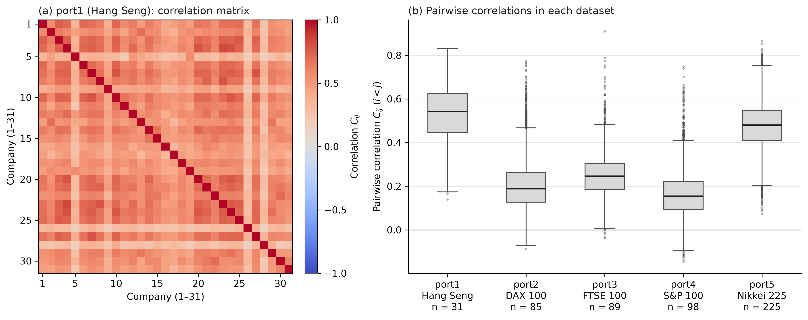

# J E Beasley's OR-Library

The data for the portfolio optimisation project is obtained from [J E Beasley's OR-Library](https://people.brunel.ac.uk/~mastjjb/jeb/orlib/portinfo.html).

There are 5 benchmark files containing weekly stock data from five equity indices:

| Data File | Market index | Assets ($n$) | Correlation records | Negative-return assets | $R_{\mathrm{eq}}$ | $R_{\max}$ | Equal-weight variance | Mean pairwise corr. |
|:---|:---|---:|---:|---:|---:|---:|---:|---:|
| [port1.txt](port1.txt) | Hang Seng (Hong Kong) | 31 | 496 | 0 / 31 | 0.350% | 1.087% | 0.001131 | 0.527 |
| [port2.txt](port2.txt) | DAX 100 (Germany) | 85 | 3,655 | 20 / 85 | 0.149% | 0.979% | 0.000265 | 0.207 |
| [port3.txt](port3.txt) | FTSE 100 (UK) | 89 | 4,005 | 4 / 89 | 0.266% | 0.821% | 0.000303 | 0.248 |
| [port4.txt](port4.txt) | S&P 100 (USA) | 98 | 4,851 | 8 / 98 | 0.287% | 0.919% | 0.000208 | 0.163 |
| [port5.txt](port5.txt) | Nikkei 225 (Japan) | 225 | 25,425 | 177 / 225 | -0.151% | 0.397% | 0.000942 | 0.476 |

## Structure of the file

```text
number of assets (n)
for each asset i (i = 1, ..., n):
    mean return, standard deviation of the return
for all possible pairs of assets:
    i, j, correlation between assets i and j
```

## Exploratory analysis



In `port1`, the single safest company (Stock #29) has variance `0.001285`, whereas splitting capital evenly across all 31 stocks lowers variance to `0.001131`. That equal split still misses higher return targets because its return is only `0.350%`. Across markets, `port2`, `port3`, and `port4` have much lower average pairwise correlations (`0.163` to `0.248`) than `port1` (`0.527`) and `port5` (`0.476`), so combining stocks cancels more variance there. `port5` also behaves differently on returns: 177 of its 225 stocks have negative weekly mean returns, pulling $R_{\mathrm{eq}}$ to `-0.151%` and leaving the $\alpha = 0.25$ target slightly negative (`-0.014%`).

On `port1` at $\alpha = 0.50$ ($R^* = 0.7185\%$), putting 100% into the highest-return asset (Stock #5) is feasible with variance `0.004776`, and a 50/50 blend of equal-weight and Stock #5 lowers variance to `0.002066`. Running the population ES variants for 30,000 evaluations brings mean variance down to `0.001171` at the same return target.

## Assignment parser validation

The `port1.txt` dataset was validated against the reference values provided in Portfolio 2026, Problem 2, page 10.

| Validation | Expected | Verified |
|---|---:|---:|
| Equal-allocation return | 0.003504064516129 | 0.003504064516129 |
| Equal-allocation variance | 0.001130937943724 | 0.001130937943724 |
| Target return ($\alpha = 0.50$) | 0.007184532258065 | 0.007184532258065 |

These checks are included in [`../tests/test_covariance.py`](../tests/test_covariance.py).
